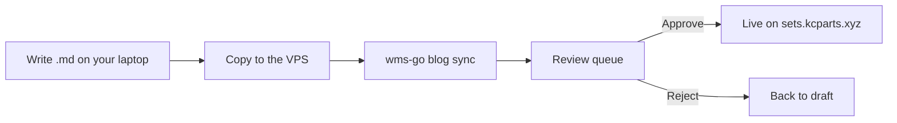

# The sets blog: adding and reviewing posts

The public sets blog (`https://sets.kcparts.xyz`) shows each set we have built and checked: photos, a short write-up and
a parts-check result. It is read-only and separate from the stock system. Nothing goes live until an admin approves it.

## How a post travels



A post is a Markdown file in the `kc-blog` repository (`posts/`). You can also write one directly in the dashboard
(**Admin → Public blog → New post**). Either way it ends up in the same review queue.

## Adding a post (writer)

1. **Write it** in `kc-blog/posts/<set-number>.md` on any machine (NixOS laptop, phone editor, anything):

   ```markdown
   ---
   slug: 21027-1
   title: "LEGO Architecture Berlin (21027)"
   set: 21027-1
   theme: Architecture
   summary: "One line shown on cards and search."
   status: building        # waiting | building | counting | checked
   audio: berlin.mp3       # optional: file in posts/audio, an https .mp3, or a YouTube link
   ---

   # About this set
   Your text here. **Bold**, - lists, > quotes and [links](https://example.com) work.
   ```

   `title` is required. The slug defaults to the file name. Use your own words, or a short quote with a link to the source.
   Images in the text must be on our own site; the build photos are added in step 3.

2. **Get it to the VPS.** Commit and push `kc-blog`, or send the file with LocalSend/rsync into `/root/kc-blog/posts/`
   (audio goes in `posts/audio/`). Then, on the VPS:

   ```
   wms-go blog sync
   ```

   Only files whose content changed are imported. A synced post always lands in **review**, never straight to live.
   Code changes to the dashboard or Go service still go through `preflight` and `wms-go-promote`; posts do not need it.

3. **Add photos** in the dashboard: **Admin → Public blog → open the post → Build photos**. Build the set first, then
   photograph each numbered bag as you open it (caption `Bag 1`, `Bag 2`, ...) and the finished set. On a phone the
   button opens the camera. Photos are re-encoded to strip location data before anyone sees them.

4. **Preview** with *Open preview*. The preview link works for anyone who has it, so do not share it before approval.

5. **Send for review** (or sync, which does it for you). Your part is done.

Editing a live post sends it back to draft until it is approved again.

## Reviewing a post (checker / admin)

Admins approve by default. An admin can give a checker the **publish** permission (Access screen → *Set checks, blog* →
`publish`) so they can approve too; `blog` alone lets someone write and send for review.

Open **Admin → Public blog**, pick a post in *review* and go through the checklist:

- [ ] Set number, title and theme match the set; the status chip is right.
- [ ] Every photo is of our own set, one per bag plus the finished model, and none shows people, addresses, order
      details or anything private.
- [ ] The text is our own words or a short quote with a link; no copied pages.
- [ ] Links open, and the audio plays if there is any.
- [ ] No names, emails or customer details anywhere. The blog keeps only a user's name and ID.
- [ ] Spelling, and the *Open preview* page looks right on a phone.

Then press **Approve and publish**, or **Reject** with a note to the writer (it goes back to draft). To take a live post
offline without deleting it, an admin uses **Hide from public**, and **Show on public site** brings it back with its
original date.

## Adding a set, editing a post, completing the section (checker / admin)

| Role | Can |
|------|-----|
| Writer (`blog`) | add a set, edit, add photos, send for review |
| Checker (`publish`) | all of the above, plus approve or reject |
| Admin | everything, plus Hide / Show on the public site |

**Add a set.** **Admin → Public blog → New post**. Use the set number as the slug (`21027-1`; lowercase letters, digits
and dashes) and the set number is filled in for you. Enter a title and press **Create draft**. Sets are also drafted
automatically when a check is queued, so look in *All posts* first.

**Edit the post.** Open it from *All posts*, change the title, set number, theme, one-line summary, audio and text, and
press **Save**. Add build photos with captions `Bag 1`, `Bag 2` ... `Finished set`, then **Open preview**. Editing a live
post sends it back to draft.

**Complete the section.** Set **Status shown** to *Waiting*, *Building*, *Counting parts* and finally *Checked* once the
parts check is done (*Automatic* follows the job). Go through the checklist above, press **Send for review**, and a
checker or admin presses **Approve and publish** (or **Reject** with a note).

## States

| State | Meaning |
|-------|---------|
| draft | being written |
| review | waiting for approval |
| published | live |
| rejected | sent back, can be fixed and re-sent |
| hidden | taken offline by an admin, can be shown again |

!!! note "Picking app"
    The warehouse picking app is coming soon. This guide will gain a section when it lands.

## The writer's steps and the last page

After a set's onboarding is complete, the writer opens the post (**Public blog → the post → Steps**) and works through:

1. **Overview.** The set's facts come from the catalog. Tick *These facts are correct*, or correct a fact and give the reason.
2. **Set parts check.** Upload your paper check (the file from *Save filled sheet*, or a scan or photo), then press **Pull from dashboard**.
   The post shows the totals (checked, missing, borrowed, extra) and, only if something was borrowed, what came from which set.
   It is a snapshot: if the set is checked again you are told to pull again.
3. **Building and photos.** Upload the instruction PDF(s) (staff only; the public post links to LEGO's own page), enter the number of bags,
   then add one photo per bag (taken after the bag is built) and one of the finished set. Use the Timestamp Camera app with the location
   and speed removed and the local time kept, and tick the box to confirm.

The **last page** (**Checks and feedback**) lists what still blocks sending the post: every section done, the check finished and its borrowed
parts recorded, a photo for every bag, and clean text (no TODO markers, no Obsidian-only syntax). It is only for the writer and the admins and
never appears on the public site. Press **Send for review** when everything is green.

Reviewers choose **Approve**, **Request changes** (needs a note) or **Reject** (needs a note). The writer gets the decision in their Inbox and
sees it live on the last page; after *changes requested* they fix the post and send it again. A post pushed from Obsidian waits as a draft
until these checks pass, so it cannot skip them.

## A set with missing parts cannot go to the blog

The blog template, **Send for review** and **Approve** are all refused while the set's last finished check still has parts
missing that no borrowed record covers (or has a line marked borrowed that is not on the Borrowed list, or has no finished
check at all). Borrowed parts count as present, so borrowing the parts from another set and recording it on the Borrowed list
(or completing the set and checking again) lifts the block. This applies to admins too. Admins can still waive or verify the
paper check and do the check itself on the dashboard, the terminal and the command line. The last page lists it as
*No parts missing*.
